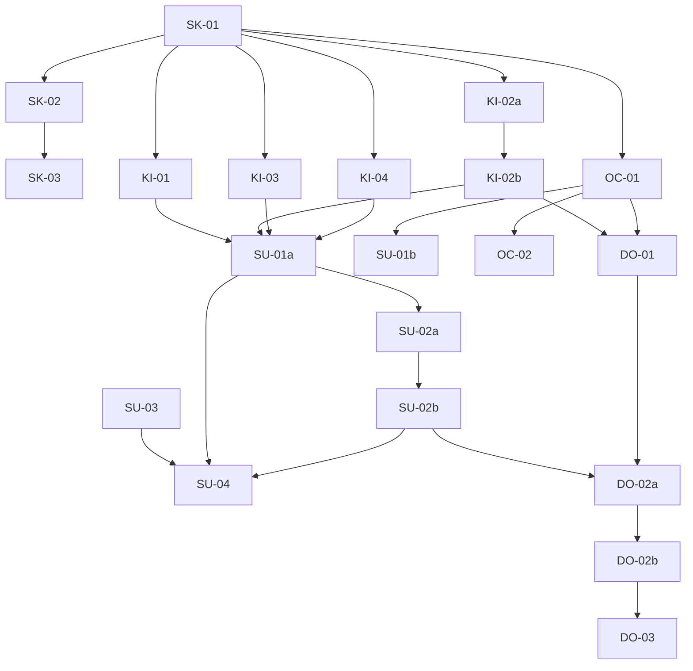

# Execution Backlog: brain-specialist

## 1. Traceability
- **Source SPEC**: `.spec/brain-specialist/SPEC.md` (RF1–RF6, I1–I7)
- **Source PLAN**: `.spec/brain-specialist/PLAN.md` (§8, 20 tasks)
- **Goal**: tickets atômicos (<2h) TDD-first, paths físicos exatos.

## 2. Sprint Summary
| Phase | ID | Type | Pri | Risk | Pts | Status |
|-------|----|------|-----|------|-----|--------|
| 1 skill | SK-01 | Doc | P0 | Low | 2 | Done |
| 1 skill | SK-02 | Doc | P0 | Low | 1 | Done |
| 1 skill | SK-03 | Test | P1 | Low | 1 | Done |
| 2 kiro | KI-01 | Config | P0 | Low | 1 | Done |
| 2 kiro | KI-02a | Config | P0 | Med | 2 | Done |
| 2 kiro | KI-02b | Test | P0 | Med | 2 | Done |
| 2 kiro | KI-03 | Config | P1 | Low | 1 | Done |
| 2 kiro | KI-04 | Doc | P1 | Low | 1 | Done |
| 3 setup | SU-01a | Infra | P0 | Med | 3 | Done |
| 3 setup | SU-01b | Infra | P1 | Low | 2 | Done |
| 3 setup | SU-02a | Infra | P0 | Med | 3 | Done |
| 3 setup | SU-02b | Test | P0 | Low | 2 | Done |
| 3 setup | SU-03 | Infra | P1 | Low | 2 | Done |
| 3 setup | SU-04 | Test | P0 | Low | 2 | Done |
| 4 oc | OC-01 | Infra | P1 | Med | 3 | Done |
| 4 oc | OC-02 | Spike | P2 | High | 2 | Done |
| 5 docs | DO-01 | Doc | P1 | Low | 2 | Done |
| 5 docs | DO-02a | Test | P0 | High | 3 | Done |
| 5 docs | DO-02b | Test | P0 | Med | 3 | Done |
| 5 docs | DO-03 | Doc | P0 | Low | 1 | Done |

## 3. Dependency Graph

## 4. Task Backlog

### Task SK-01: roteiro deepsearch na skill
- Ref: RF1/ADR-2/I1. Dep: none (Hard). Layer: Docs. Type: Doc. P0/Low. Paralelo: No.
- Artifact: `.agents/skills/brain/SKILL.md` (+seção 5 passos). Enforcement: I1.
- Failure: sem roteiro → agentes voltam ao search raso.
- BDD: (1) Success: agente segue 5 passos e cita paths — Given skill lida, When feature pedida, Then tabela decisão→fonte. (2) Failure: busca vazia não declarada — Given 0 hits, When síntese, Then "sem contexto" explícito. (3) Edge: query com paráfrase — Given prompt, When busca, Then query literal usada.
- TDD: [ ] grep I1 (1 ocorrência "deepsearch" fonte) [ ] escrever seção.
- DoD: seção presente; I1 verde; sem duplicar roteiro em outro arquivo.

### Task SK-02: ponte BRAIN.MCP + anti-drift
- Ref: RF6/ADR-2. Dep: SK-01. Type: Doc. P0/Low.
- Artifact: `.agents/rules/BRAIN.MCP.md` (+3 linhas). Failure: ponte com roteiro colado → drift.
- BDD: (1) ponte aponta p/ skill. (2) Failure: roteiro colado na ponte → grep acusa. (3) Edge: skill move de path → ponte quebrada detectada.
- TDD: [ ] teste/grep roteiro==1x [ ] escrever ponte.
- DoD: ponte ≤5 linhas; grep verde.

### Task SK-03: self-review spec-gate adaptado
- Ref: I7. Dep: SK-01–02. Type: Test. P1/Low.
- BDD: (1) checklist N/A-justificado passa. (2) Failure: item sem justificativa → fail. (3) Edge: gate Java puro (Flyway) → N/A com motivo.
- TDD: [ ] checklist em arquivo [ ] executar e anexar resultado.
- DoD: zero 🔴; 🟠 só com decisão explícita registrada.

### Task KI-01: brain-session.json estático
- Ref: RF2/C1. Dep: SK-01. Type: Config. P0/Low.
- Artifact: `hooks/kiro/brain-session.json`. Failure: trigger fora da lista → hook morto.
- BDD: (1) 2 hooks disparam (prompt→start, Stop→end). (2) Failure: trigger inválido rejeitado. (3) Edge: `$$` literal (sem shell) → documentado.
- TDD: [ ] validador triggers/payload [ ] copiar conteúdo fiel ao gerador.
- DoD: byte-equivalente funcional ao `kiro_hook_json`; sem `--db`; sem hardcoded.

### Task KI-02a: brain-learning.json
- Ref: RF3/ADR-3. Dep: SK-01. Type: Config. P0/Med.
- Artifact: `hooks/kiro/brain-learning.json` (agent/Stop + template 3 camadas + loop qualidade).
- Failure: sem guard → spam por turno.
- BDD: (1) turno substancial instrui handoff MCP. (2) Failure: turno trivial → skip. (3) Edge: MCP fora → instrui retry manual, sem CLI direto.
- TDD: [ ] teste sanidade (KI-02b cobre) [ ] escrever prompt ≤40 linhas.
- DoD: cita skill (ponte, não roteiro); path relativo; scope correto.

### Task KI-02b: guard + sanidade
- Ref: I2/I3. Dep: KI-02a. Type: Test. P0/Med.
- BDD: (1) hardcoded/projeto no json → fail. (2) Failure: trigger fora da lista → fail. (3) Edge: prompt >40 linhas → warn (custo loop).
- TDD: [ ] script teste [ ] verde contra KI-02a/03/04.
- DoD: 3/3 asserts verdes.

### Task KI-03: brain-prompt-optimizer.json
- Ref: RF2. Dep: SK-01. Type: Config. P1/Low.
- BDD: (1) UserPromptSubmit injeta instrução deepsearch. (2) Failure: somente-leitura → dispensa. (3) Edge: duplo disparo com command → sem duplicar contexto.
- TDD: [ ] sanidade KI-02b [ ] escrever prompt.
- DoD: verde no sanidade.

### Task KI-04: steering brain-learning.md
- Ref: RF3. Dep: SK-01. Type: Doc. P1/Low.
- BDD: (1) regra buscar-antes/gravar-depois legível. (2) Failure: path absoluto/exemplo hardcoded → fail sanidade. (3) Edge: conflito com steering do usuário → merge manual documentado.
- TDD: [ ] sanidade [ ] escrever steering.
- DoD: ≤30 linhas; ponte p/ skill.

### Task SU-01a: setup kiro copia estáticos
- Ref: RF4/ADR-6/I5. Dep: KI-01–04. Type: Infra. P0/Med.
- Artifact: `crates/brain-cli/src/setup.rs` (+copy fns) + testes Rust.
- Failure: overwrite sem `.bak` → perda custom (R3).
- BDD: (1) install limpo copia 4 arquivos. (2) Failure: destino com custom → `.bak` + aditivo, sem `--force` não sobrescreve. (3) Edge: `--dry-run` → 0 writes.
- TDD: [ ] testes `kiro_target` (created/overwritten/skipped/dry-run) [ ] implementar cópia.
- DoD: 4/4 cenários verdes; `cargo test -p brain-cli` ok.

### Task SU-01b: setup opencode plugin+skill
- Ref: RF4. Dep: OC-01. Type: Infra. P1/Low.
- BDD: (1) plugin registrado + skill ref no opencode.json. (2) Failure: plugin já registrado → merge sem duplicar. (3) Edge: dry-run 0 writes.
- TDD: [ ] testes merge [ ] implementar.
- DoD: idempotente.

### Task SU-02a: doctor D1–D6
- Ref: RF4/ADR-6/I6. Dep: SU-01a. Type: Infra. P0/Med.
- Artifact: subcomando `doctor` (CLI) + saída `ok/warn/fail` + "como corrigir".
- Failure: diagnóstico opaco → usuário travado.
- BDD: (1) install ok → verde D1–D6. (2) Failure: hook faltando → fail + caminho exato. (3) Edge: MCP down → D4 warn (não fail).
- TDD: [ ] testes matriz [ ] implementar checks.
- DoD: 6 checks binários; nenhuma credencial impressa.

### Task SU-02b: testes doctor
- Ref: I6. Dep: SU-02a. Type: Test. P0/Low.
- BDD: (1) scratch verde. (2) Failure: cada D removido → fail correspondente. (3) Edge: `BRAIN_OLLAMA_URL` morto → ainda verde (D4 warn).
- TDD: [ ] fixtures scratch [ ] matriz 7 cenários.
- DoD: 7/7 verdes.

### Task SU-03: brain-hook.sh moderno
- Ref: RF5/C2. Dep: none. Type: Infra. P1/Low.
- Artifact: `hooks/brain-hook.sh` (binário `brain`, truncamento, throttle).
- Failure: `uv run` inexistente → hook silenciosamente morto.
- BDD: (1) 4 eventos via binário. (2) Failure: MCP down → warn + exit 0. (3) Edge: tool-result em rajada → 1 nota agregada (throttle).
- TDD: [ ] shellcheck + teste morto-vivo [ ] reescrever.
- DoD: shellcheck limpo; dead-backend verde.

### Task SU-04: suite verde H6
- Ref: SPEC §9. Dep: SU-01–03. Type: Test. P0/Low.
- BDD: (1) 494/0 + clippy 0 + pytest 124/2-legadas. (2) Failure: qualquer vermelho → fase não completa. (3) Edge: flake → re-rodar 1x, se persistir vira bug P1.
- TDD: [ ] rodar suite [ ] anexar contagens.
- DoD: H6 completo.

### Task OC-01: plugin sessão opencode
- Ref: RF2. Dep: SK-01. Type: Infra. P1/Med.
- Artifact: `hooks/opencode/brain-session.js` (estende `opencode_plugin_js`).
- Failure: hook em evento inexistente no runtime → silencioso (cf. reality-check).
- BDD: (1) created injeta resumo; idle sugere handoff. (2) Failure: MCP down → sem injeção, sem erro. (3) Edge: sessão compactada sem resumo → degradado documentado.
- TDD: [ ] teste contra runtime instalado (lista eventos reais) [ ] implementar.
- DoD: só eventos verificados no binário instalado.

### Task OC-02: spike compacting
- Ref: ADR-6. Dep: OC-01. Type: Spike. P2/High. Timebox 2h.
- BDD: (1) resumo brain entra na compactação. (2) Failure: API instável → desce p/ roadmap com evidência. (3) Edge: contexto gigante → truncado.
- TDD: [ ] spike script [ ] decisão go/no-go escrita.
- DoD: decisão documentada, sem código morto se no-go.

### Task DO-01: docs matriz IDE
- Ref: RF6. Dep: KI-02b, OC-01. Type: Doc. P1/Low.
- Artifact: `hooks/README.md` + `AGENTS.md` (setup/agent-hooks/steering/doctor/global).
- BDD: (1) operador instala só lendo docs. (2) Failure: doc cita arquivo inexistente → grep acusa. (3) Edge: `~/.kiro/hooks/` global documentado.
- TDD: [ ] grep arquivos citados existem [ ] escrever.
- DoD: 0 refs quebradas.

### Task DO-02a: demo setup+doctor
- Ref: RF4/R1. Dep: SU-02b, DO-01. Type: Test. P0/High.
- BDD: (1) scratch kiro+opencode → doctor verde. (2) Failure: trigger delegação diverge → log + matcher amplo (R1 mitigado). (3) Edge: prod 8321/8322 intocados (lsof prova).
- TDD: [ ] roteiro demo [ ] executar e anexar evidências.
- DoD: doctor verde; prod intacta.

### Task DO-02b: demo handoff pesquisável
- Ref: RF3/R2. Dep: DO-02a. Type: Test. P0/Med.
- BDD: (1) handoff 3 camadas achado via `brain_search`. (2) Failure: estudo sem loop → reprovado e refeito. (3) Edge: spam ≤5 notas/dia/projeto.
- TDD: [ ] executar fluxo [ ] search + contagem.
- DoD: achado top-3; spam ok.

### Task DO-03: zero marcadores de assunção + handoff Fase 3
- Ref: I7. Dep: DO-02b. Type: Doc. P0/Low.
- BDD: (1) grep pelo token de assunção: 0 hits. (2) Failure: restante → vira decisão explícita ou débito. (3) Edge: handoff delegação pronto (tasks, contexto, aceite).
- TDD: [ ] grep [ ] escrever handoff.
- DoD: 0 hits; prompt delegação pronto.

## 5. Coverage Validation
- [x] 20/20 PLAN tasks convertidas (SK 3, KI 5, SU 6, OC 2, DO 4).
- [x] Constraints C1–C5 em BDDs (triggers, spam, uv-run, fronteiras, allowlist/fail-open/merge, gates).
- [x] Failure mode em todo ticket; edge em todo ticket.
- [x] Grafo §3 acíclico, sem órfãs (todas conectadas).
- [x] TDD-first em todo ticket; DoD por ticket.

## 6. Plan Feedback
- PLAN sem tarefa explícita p/ `brain-hook.py` (deprecated, Z-01 decide não mexer) — ok, coberto por SU-03 apenas no `.sh`.
- OC-02 timebox impede spike infinito — divergência intencional de granularidade, aceita.
