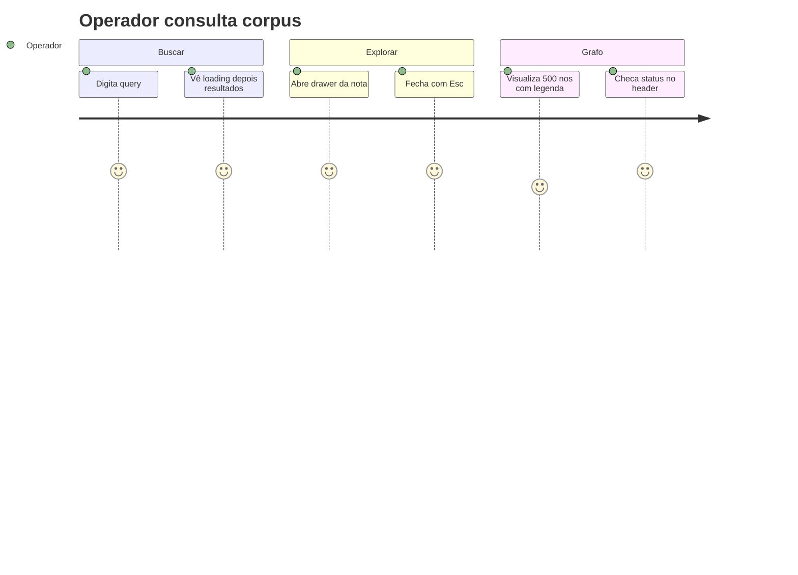

# Architecture & Software Specification: viewer-product-graph

> **ID**: `viewer-product-graph`
> **Status**: `Draft — pending approval`
> **Author**: sdd-compiler generate-spec
> **Date**: 2026-10-15
> **Source**: `.spec/viewer-product-graph/PROPOSAL.md` (gate 12/12 PASS) + Architect Batch 1 (VIEW-01..03) + PM Batch 2 (US1-5) + ux-designer vinculante §9 PROPOSAL

---

## 1. Architecture Decision Records (ADRs)

### VIEW-01: Refactor exclusivamente visual, restrito a `viewer/index.html`
- **Decision**: Único diff produto permitido é `viewer/index.html` (HTML+CSS+JS inline). Nenhuma crate Rust tocada; `/api/*` congelado.
- **Context**: Viewer é estático servido por `brain_web::router` (`frontend-rules.md`); contratos `/api/status,search,read,list,graph,events` já suprem os 3 tabs. Risco mapeado: scope creep para `/api/*` ou SPA.
- **Trade-offs**: Ganha zero regressão backend + review trivial (`git diff --name-only` gate); perde agregação server-side — grafo agrega no cliente (cap + freeze mitigam O(n²)).
- **Gate**: `git diff --name-only` contém só `viewer/index.html` (+ `.spec/` governança). Qualquer outro arquivo produto = violação.

### VIEW-02: Sem framework, sem build, sem CDN — canvas force-directed próprio
- **Decision**: Manter canvas próprio (~8–12 KB JS, `requestAnimationFrame`, pan/zoom por transform). Sem Vue/Pinia/PrimeVue, sem lib externa.
- **Context**: No-SPA Rule Fase A+B (`frontend-rules.md`); padrão `viewer-graph` existente já prova o approach (freeze >1500, deriva 0.2×, `prefers-reduced-motion` estático).
- **Trade-offs**: Ganha zero deps + zero build + funciona offline de CDN; perde conveniência de lib (anti-colisão e cap implementados à mão — custo aceito, escopo fechado).
- **Constraint**: Nenhum `<script src>` / `@import` remoto. Inline apenas.

### VIEW-03: Reutilizar contratos existentes, sem endpoint novo
- **Decision**: Tabs consomem só o que já existe — Buscar→`GET /api/search?query=&top_k=`, Explorar→`GET /api/list` + `GET /api/read?path=`, Grafo→`GET /api/graph?project=` (ids verbatim → `/api/read`), Header→`GET /api/status` (coverage + `queue.*`), live→`GET /api/events` SSE (`graph-changed`, polling 2 s) via `ensureGraphEventSource()` idempotente.
- **Context**: Architect Batch 1 congela `/api/*`; `AppState{db:String}` per-request e `Store` Send-não-Sync não afetados (nenhum código Rust muda).
- **Trade-offs**: Ganha `cargo test -p brain-web` como regressão gratuita (API inalterada); perde query agregada — filtro `?project=` existente reutilizado, sem filtro novo.
- **Constraint**: Nenhum query-param novo, nenhum campo novo em resposta JSON.

---

## 2. Domain Context, Tenant Strategy & Provisioning
- **Bounded Context**: Viewer read-only do corpus `brain.db` (diagnóstico/navegação do operador). Fora do contexto: escrita, auth, multi-projeto além do filtro `?project=` existente.
- **System Type**: Frontend estático (single-file `viewer/index.html`, 692 linhas) sobre backend read-only `brain-web` axum (`:8322`).
- **Tenant Provisioning**: N/A — viewer não tem conceito de tenant; isolamento não aplicável. Filtro `?project=` é navegação, não isolamento (decisão explícita PROPOSAL §4).
- **Tenant Lifecycle**: N/A pelo mesmo motivo.

## 3. Identity & Access Management (IAM)
- **N/A — justificado**: viewer é ferramenta local read-only sem login (bind loopback/`0.0.0.0` operador-local, sem RBAC). Nenhuma permissão nova, nenhum papel, nenhum token. `spec-gate.md` exige JWT/`@HasPermission` — item avaliado explicitamente e declarado não-aplicável (PROPOSAL §4 "avaliado explicitamente"). Qualquer PLAN/TASK que introduza auth estaria fora do escopo (gate VIEW-01 barra).

## 4. Security, Key Management (KMS) & Disaster Recovery
KMS/BDR/PITR/RTO/RPO: N/A (nenhum segredo, nenhum dado novo, nenhuma migração — `SCHEMA_VERSION 4` intacto).
Segurança aplicável a esta feature (§ dedicada, normativa):

- **SEC-01 XSS**: Todo conteúdo vindo de `/api/search` (snippets), `/api/read` (corpo da nota), `/api/list`/`/api/graph` (`layer`/`path`/ids) e strings de erro/status passa por `escapeHtml()` antes de qualquer inserção no DOM. Escopo `escapeHtml`: função única cobrindo todos os sinks (snippet busca, corpo drawer, `layer`/`path`/id, mensagem erro, `API_BASE`/badge). **Proibido** `innerHTML` com conteúdo cru e **proibido** `onclick` inline interpolado (H-01); permitido apenas `innerHTML` com string já escapada ou template estático. Interação via `data-*` + `addEventListener` delegado (sem handler inline). Critério: injetar `` como conteúdo de nota → renderiza como texto literal, nenhum alerta, nenhum request.
- **SEC-02 Timeout**: Os 5 `fetch` (`/api/status`, `/api/search`, `/api/list`, `/api/read`, `/api/graph` — `GET /api/events` é SSE, fora da lista) usam `AbortSignal.timeout(3000)` (ou `AbortController` equivalente 3 s); timeout → estado de erro explícito + badge `degraded/offline` (§ RF-13), nunca UI pendente infinita. Erros exibidos via `textContent` ou string escapada (H-02), nunca `innerHTML` cru com texto de erro.
- **SEC-03 Sem segredos**: Nenhuma credencial, token ou `BRAIN_*` no cliente. `API_BASE` exibido no footer é origem/host apenas (escapado via `escapeHtml()`).
- **SEC-04 Superfície**: Nenhum novo sink (sem `eval`, sem `Function()`, sem `outerHTML` com dado, sem `document.write`, sem `onclick` inline). URLs montadas com `encodeURIComponent()` em todo parâmetro (`query`, `path`/id verbatim, `project`) — RF-11/`?project=` incluídos (H-01/SEC-04).

## 5. Data Model & Concurrency
Sem modelo novo, sem migração, sem escrita. Contratos reutilizados (read-only, verbatim de `frontend-rules.md` + VIEW-03):

| Endpoint | Resposta consumida | Uso |
|----------|--------------------|-----|
| `GET /api/status` | `{notes,chunks,projects, coverage_pct, queue.*}` | badge US3/US5 |
| `GET /api/search?query=&top_k=` | `results[]` | tab Buscar |
| `GET /api/list` | entries | tab Explorar |
| `GET /api/read?path=` (id verbatim) | nota integral | Explorar + drawer |
| `GET /api/graph?project=` | `{nodes,edges,dangling,projects}` | tab Grafo |
| `GET /api/events` SSE | `graph-changed` | live update grafo |

- **ERD**: N/A — nenhuma entidade nova (gate avaliado; justificativa: feature não cria nem altera tabela).
- **Concurrency**: N/A escrita. Concorrência única é RAF-loop vs SSE: `renderGraph()` cancela só o RAF e garante a fonte aberta; `stopGraph()` fecha `EventSource` só ao sair da view (idempotente `ensureGraphEventSource()`).

## 6. Event Model, Integrations & Messaging Isolation
- **Nenhum evento novo.** Reutiliza `graph-changed` sobre `GET /api/events` (`text/event-stream`, polling 2 s sobre snapshot `(count_notes(), count_chunks())`).
- **Event Registry**: N/A novo; único evento consumido é `graph-changed` (producer `brain-web`, consumer viewer, payload inalterado, sem idempotency nova).
- **Messaging Isolation**: N/A (sem tenant, sem broker novo).

## 7. Invariants & Property-Based Testing (PBT)

### 7.1 Entity Invariants (UI state — testáveis via DOM)
| ID | Invariant | Descrição |
|----|-----------|-----------|
| INV-01 | Uma tab ativa por vez | Exatamente um tab `[aria-selected=true]` entre Buscar/Explorar/Grafo em qualquer estado |
| INV-02 | Drawer modal | Drawer aberto ⇒ foco dentro do drawer; `Esc` sempre fecha drawer antes de limpar busca |
| INV-03 | Labels ≤ cap | Nós com label visível ≤ 40 em qualquer frame renderizado (500 ou 1500 nós) |
| INV-04 | Legenda fixa | 6 hex §9 presentes e imutáveis em qualquer re-render |
| INV-05 | Sem toast | Zero elementos toast em qualquer fluxo; feedback só via banner inline |
| INV-06 | SSE único | No máximo um `EventSource` aberto por sessão de view Grafo (idempotência) |

### 7.2 Workflow & State Invariants
- **Busca**: `idle → loading → (results | empty | error)`; `loading` sempre exibe indicador; nunca `results` + `empty` simultâneos.
- **Grafo**: `nós > 1500 ⇒ layout congelado + anúncio visível` (nunca congela silencioso).
- **Status**: `coverage < 100% ⇒ badge exibe (N awaiting embed)`; nunca badge `online` puro com fila pendente.
- **Motion**: `prefers-reduced-motion ⇒ grafo estático` (zero RAF de animação; pan/zoom manual permitido).

### 7.3 Generator Constraints (para PLAN/TASKS derivarem testes)
| Campo | Constraint | PBT Goal |
|-------|-----------|----------|
| corpus nós | 0, 1, 40, 41, 500, 1500, 1501 | cap/freeze boundaries |
| query | `""`, `"*():{}=-/"`, ``, 256 KiB | FTS escape + XSS + limites |
| viewport | 360px, 768px, 1280px | bottom-sheet só em mobile |
| SSE | disconnect mid-view, reconnect, duplo `ensure` | lifecycle idempotente |
| fetch | timeout >3 s, 500, offline | badge + banner erro |

## 8. Functional Requirements & Core Journeys

Mapeamento US (PM Batch 2) → RF. Cada RF tem critério verificável (teste 5 s + Lighthouse do aceite).

### US1 — Busca com feedback (Must)
- **RF-01 Tabs**: 3 tabs Buscar/Explorar/Grafo, navegação única (sem views paralelas). Verificável: clicar cada tab ativa só ela (`aria-selected`), URL hash opcional sem recarregar.
- **RF-02 Estados de busca**: `loading` (spinner), `empty` (0 match → mensagem + sugestão), `error` (fetch falha/timeout → banner inline com retry). Verificável: simular cada estado, assert DOM.
- **RF-03 Esc limpa busca**: `Esc` com drawer fechado limpa query + resultados e retorna a `idle`. Verificável: digitar → `Esc` → input vazio + estado `idle`.
- **RF-04 Banner inline, sem toast**: Todo feedback via banner inline na região da busca; zero toast. Verificável: executar fluxos erro/vazio, `document.querySelector('[data-toast]') === null`.

### US2 — Grafo legível até 500 nós (Must)
- **RF-05 Render 500 ≤ 5 s**: Corpus 500 nós renderiza interativo em ≤5 s. Ambiente normado: Chromium estável, viewport 1280×720, fixture local `fixture-graph-500.json` (500 nós determinísticos) + meta anexada à medição `{chromium, viewport, corpus hash, tempo até frame interativo}`. Verificável: harness com fixture 500 nós, cronometrar até primeiro frame interativo.
- **RF-06 Cap 40 + anti-colisão**: Máximo 40 labels visíveis; overlap resolvido (ocultação por prioridade, nunca sobreposição ilegível). Método normado: viewport 1280×720, contar labels via contador debug canvas/DOM (`__labelCount` ou equivalente observável) em 500 nós → ≤40; anti-colisão verificada por zero bounding-box sobreposto em amostra mínima de 40 labels visíveis (toda a amostra, não subconjunto). Verificável: fixture 500 nós a 1280px → `labels ≤ 40` + `overlap = 0` na amostra.
- **RF-07 Legenda 6-hex fixa**: Noite `#0d1117`, Papel `#c9d1d9`, Link `#58a6ff`, Trilha `#3fb950`, Guia `#f0883e`, Orfã `#484f58`. Verificável: assert valores computados.
- **RF-08 Simbologia + alfa**: Hub `projeto:<nome>` quadrado Guia 6px; nota círculo 3px; órfã círculo vazado Orfã; alfa arestas **0.55** em hover/seleção (base 0.35). Verificável: inspeção visual + assert constante no fonte.
- **RF-09 Freeze >1500**: Acima de 1500 nós layout congela + anúncio visível + deriva lenta 0.2× abaixo do teto. Verificável: fixture 1501 nós → anúncio presente, RAF de layout parado.

### US3 — Header de produto (Must)
- **RF-10 Header + footer**: Título produto + badge status + footer com `API_BASE`. Verificável: DOM contém os três; footer reflete origem efetiva.

### US4 — Drawer lateral de leitura (Should)
- **RF-11 Drawer**: Abre via `/api/read` com id verbatim codificado por `encodeURIComponent()` ao clicar nó/resultado (interação via `data-*` + delegado, sem `onclick` inline); `Esc` fecha e devolve foco ao invocador (foco-Esc: drawer→retorna ao elemento que abriu; busca→foco permanece no input); mobile 360px vira bottom-sheet; tabs scrolláveis. Verificável: click → conteúdo idêntico ao `/api/read`; `Esc` → fechado + `document.activeElement` = invocador; viewport 360px → classe bottom-sheet.

### US5 — Status visível (Should)
- **RF-12 Badge status**: `online` / `degraded` / `offline` derivado de `/api/status` (health + timeout 3 s); precedência normada `offline > degraded > online` (qualquer fetch abort/offline ⇒ `offline`; `coverage < 100%` ou timeout parcial ⇒ no mínimo `degraded` com sufixo `(N awaiting embed)`). Verificável: mock status + Ollama down → `degraded (N awaiting embed)`; fetch abort → `offline`.
- **RF-13 A11y ≥90**: Lighthouse acessibilidade ≥90 + AA: `canvas role=img` com `aria-label` descritivo, controles com `aria-*`, região de busca/banner com `aria-live="polite"` (resultados + banner anunciados), foco gerenciado no drawer, `prefers-reduced-motion` → estático. Verificável: audit Lighthouse + teste `matchMedia('(prefers-reduced-motion: reduce)')` → zero animação.

**RF count: 13** (RF-01..RF-13). Cobertura US: US1→RF-01..04, US2→RF-05..09, US3→RF-10, US4→RF-11, US5→RF-12..13.



## 9. UX vinculante (ux-designer — não-negociável, verbatim PROPOSAL §9)

1. **Tabs**: 3 tabs — Buscar / Explorar / Grafo (navegação única, sem views paralelas).
2. **Drawer**: lateral de leitura; em mobile vira bottom-sheet (viewport referência 360px); `Esc` fecha drawer e limpa busca.
3. **Legenda**: 6 hex fixa — Noite `#0d1117`, Papel `#c9d1d9`, Link `#58a6ff`, Trilha `#3fb950`, Guia `#f0883e`, Orfã `#484f58`.
4. **Grafo**: cap 40 labels + anti-colisão; alfa arestas 0.35→0.55 (hover/seleção); hub `projeto:<nome>` quadrado Guia 6px; nota círculo 3px; órfã círculo vazado Orfã.
5. **Feedback**: banner inline, sem toast; estados loading/erro/vazio explícitos na busca.
6. **A11y**: AA + `aria-*` nos controles + `canvas role=img` com descrição textual; `prefers-reduced-motion` → grafo estático.
7. **Mobile**: layout utilizável em 360px (drawer bottom-sheet, tabs scrolláveis).

## 10. Edge Cases (normativos)

| # | Caso | Comportamento exigido |
|---|------|----------------------|
| EC-01 | 0 match | Estado `empty` com mensagem + sugestão fixa (`Tente um termo mais amplo ou verifique o filtro de projeto`) (não tela em branco, não erro) |
| EC-02 | API down / timeout 3 s | Banner erro + retry; badge `offline`; busca volta a `idle` recuperável |
| EC-03 | >1500 nós | Freeze layout + anúncio visível (padrão `viewer-graph`); deriva 0.2× |
| EC-04 | `prefers-reduced-motion` | Grafo estático; nenhum RAF de animação |
| EC-05 | XSS (``, `<script>` em snippet/nota) | Renderiza como texto literal via `escapeHtml()`; zero execução |
| EC-06 | SSE disconnect mid-view | Banner sutil ou badge; `ensureGraphEventSource()` reconecta idempotente; nunca duplica fonte |
| EC-07 | Query especial `*():{}=-/` | Passa ao FTS sem quebrar (escape existente); sem 500 |
| EC-08 | Drawer em 360px | Bottom-sheet, sem overflow horizontal, `Esc` fecha |

## 11. Test Strategy
- **API congelada**: `cargo test -p brain-web` verde (zero regressão; nenhum teste novo de backend — nenhum handler muda).
- **Frontend manual-guiado + gate CI textual** (sem harness JS no repo): checklist por RF — fixture 500 nós ≤5 s Chromium 1280px + meta (RF-05), contagem labels ≤40 a 1280px + overlap 0 na amostra de 40 (RF-06), hex assert (RF-07), freeze 1501 + anúncio (RF-09), `Esc`/foco ao invocador (RF-03/RF-11), `aria-live` presente (RF-13), badge precedência (RF-12), sugestão empty fixa (EC-01), XSS literal incluindo `layer`/`path`/erro (SEC-01), timeout→`offline` nos 5 fetches (SEC-02/RF-12), Lighthouse a11y ≥90 (RF-13), viewport 360px (RF-11), `git diff --name-only` gate (VIEW-01). Gate textual CI (grep no fonte, sem executar produto): `encodeURIComponent` presente; `escapeHtml` presente; `AbortSignal.timeout` ou `AbortController` presente; zero `onclick=` interpolado; `aria-live` presente; 6 hex presentes.
- **PLAN deve** transformar cada RF/EC em task TDD-ready com critério verificável acima (rastreabilidade 1:1 SPEC→PLAN→TASKS).

---

## Delta Specs: viewer-product-graph

> **Feature ID**: `viewer-product-graph`
> **SPEC Source**: `.spec/viewer-product-graph/SPEC.md`
> **Purpose**: Rastrear exatamente o que muda em documentos existentes quando esta feature for arquivada.

---

## Delta: `.agents/rules/frontend-rules.md`

### MODIFIED
> **Seção alvo**: `## Aba Grafo (viewer-graph)`
```
## Aba Grafo (viewer-graph)
- 4ª view `renderGraph()` em `viewer/index.html`: canvas force-directed próprio (~8–12 KB JS, `requestAnimationFrame`, pan/zoom por transform), sem deps/build/CDN; lê `GET /api/graph?project=` (`{nodes,edges,dangling,projects}`, ids verbatim p/ `/api/read`, hubs `projeto:<nome>`); layout congela acima de 1500 nós com anúncio visível; deriva lenta 0.2× abaixo do teto, `prefers-reduced-motion` → estático
- Produto (viewer-product-graph): 3 tabs Buscar/Explorar/Grafo (navegação única); drawer lateral de leitura via `/api/read` (id verbatim, `Esc` fecha, bottom-sheet em 360px, tabs scrolláveis); legenda 6-hex fixa (Noite `#0d1117`, Papel `#c9d1d9`, Link `#58a6ff`, Trilha `#3fb950`, Guia `#f0883e`, Orfã `#484f58`); cap 40 labels + anti-colisão; alfa arestas 0.35→0.55 (hover/seleção); hub quadrado Guia 6px, nota círculo 3px, órfã círculo vazado; header produto com badge status (`/api/status` coverage + `queue.*`, `(N awaiting embed)` abaixo de 100%) + footer `API_BASE`; feedback por banner inline (loading/erro/vazio, sem toast); `Esc` limpa busca; SSE `ensureGraphEventSource()` idempotente mantido; fetch com `AbortController` 3 s; XSS via `escapeHtml()` (sem `innerHTML` cru)
```
> **Inserir após**: (substitui a seção `## Aba Grafo` existente; demais seções do arquivo inalteradas)

---

## Delta: `viewer/index.html`

### MODIFIED
> **Seção alvo**: arquivo inteiro (único diff produto — tabs + drawer + header + legenda + cap labels + banner inline, sem tocar `/api/*`)
```
Refactor visual viewer-product-graph (detalhe implementado na fase TASKS; fronteira: só viewer/index.html muda).
```

---

## Delta: `crates/brain-web/src/lib.rs` (`/api/*`)

### NONE
> Contratos `status,search,read,list,graph,events` congelados — nenhuma mudança (VIEW-01/03).

---

## Delta: `AGENTS.md`

### NONE
> Tabela de tools inalterada (sem nova tool MCP/CLI).

---

## Delta: `.agents/skills/brain/SKILL.md`

### NONE
> Sem nova tool/skill; viewer não é tool MCP.

---

## Resumo do Impacto

| Documento | ADDED | MODIFIED | REMOVED |
|-----------|-------|----------|---------|
| `.agents/rules/frontend-rules.md` | 0 seções | 1 seção (`## Aba Grafo`) | 0 |
| `viewer/index.html` | 0 | 1 (arquivo, só produto) | 0 |
| `crates/brain-web/src/lib.rs` (`/api/*`) | 0 | 0 (NONE) | 0 |
| `AGENTS.md` | 0 (NONE) | 0 | 0 |
| `.agents/skills/brain/SKILL.md` | 0 (NONE) | 0 | 0 |

---

## Self-Validation contra `asserts/spec-gate.md`

| Gate | Status | Evidência |
|------|--------|-----------|
| ADRs com "Porquê" | ✅ PASS | VIEW-01..03 com Decision/Context/Trade-offs |
| DDD Modular (camadas respeitadas) | ✅ PASS | Fronteira só viewer; nenhuma crate cruzada (§4 Architecture Impact PROPOSAL, VIEW-01 gate `diff --name-only`) |
| Segurança/IAM (JWT/`@HasPermission`) | ⚠️ N/A justificado | Viewer local read-only sem auth; avaliado explicitamente PROPOSAL §4; SEC-01..04 cobrem superfície real (XSS/timeout/sem segredos) |
| ERD | ⚠️ N/A justificado | Nenhuma entidade nova; contratos reutilizados tabelados §5 |
| Event Registry | ⚠️ N/A justificado | Nenhum evento novo; `graph-changed` reutilizado documentado §6 |
| Migrations Flyway `V{date}` | ✅ PASS (negativo) | `SCHEMA_VERSION 4` intacto, sem DDL — corretamente ausente |
| Invariantes de Entidade | ✅ PASS | INV-01..06 |
| Invariantes de Workflow | ✅ PASS | Busca/Grafo/Status/Motion §7.2 |
| Test Strategy | ✅ PASS | §11 (brain-web verde + checklist RF + Lighthouse + gate diff) |
| Single File | ✅ PASS | Este arquivo único |
| Domínio claro | ✅ PASS | Viewer (`frontend-rules.md`, `brain-web` read-only) |

**Gate: PASS com 3 N/A justificados** (IAM/ERD/Eventos — feature read-only sem backend). Nenhum gap bloqueante. Próximo passo: `generate-plan` (1:1 RF→tasks).
