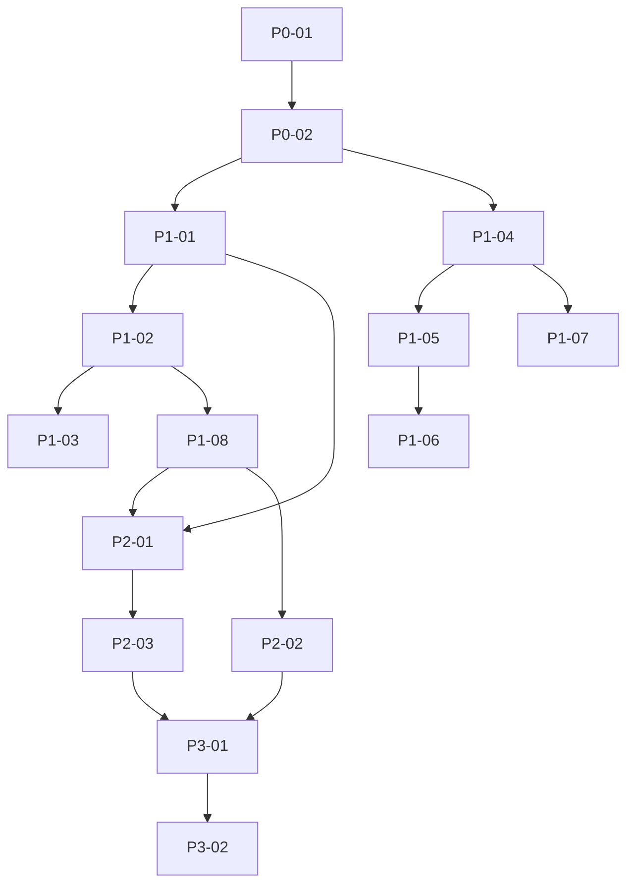

# Execution Backlog: viewer-product-graph

## 1. Traceability Context
- **Source SPEC**: `.spec/viewer-product-graph/SPEC.md` (13 RF RF-01..RF-13 + SEC-01..SEC-04 + EC-01..EC-08 + INV-01..INV-06, gate PASS com 3 N/A justificados)
- **Source PLAN**: `.spec/viewer-product-graph/PLAN.md` (Phase 0 bootstrap + P1 Must + P2 Should + P3 Could, aceite A-01..A-13 + A-SEC-01/02 + E-01..E-08 + gate textual CI)
- **Goal**: Explodir 15 tasks do PLAN §8 em tickets TDD-ready executáveis em <2h, restritos a `viewer/index.html` (VIEW-01) + `.spec/`, sem tocar `/api/*`, sem deps/build/CDN.

## 2. Sprint Summary
| Phase | Task ID | Type | Priority | Risk | Complexity | Status |
|-------|---------|------|----------|------|------------|--------|
| P0 bootstrap | P0-01 | Infra/Test | P0 | Low | 0.5pt | Done |
| P0 bootstrap | P0-02 | Infra/Test | P0 | Low | 0.5pt | Done |
| P1 Must | P1-01 | Frontend | P0 | Medium | 1pt | Done |
| P1 Must | P1-02 | Frontend | P0 | Medium | 1pt | Done |
| P1 Must | P1-03 | Frontend | P1 | Low | 0.5pt | Done |
| P1 Must | P1-04 | Frontend | P0 | High | 2pt | Done |
| P1 Must | P1-05 | Frontend | P0 | High | 2pt | Done |
| P1 Must | P1-06 | Frontend | P1 | Low | 1pt | Done |
| P1 Must | P1-07 | Frontend | P1 | Medium | 1pt | Done |
| P1 Must | P1-08 | Frontend | P0 | Low | 1pt | Done |
| P2 Should | P2-01 | Frontend | P1 | Medium | 2pt | Done |
| P2 Should | P2-02 | Frontend/Sec | P0 | Medium | 2pt | Done |
| P2 Should | P2-03 | Frontend/A11y | P1 | Medium | 1pt | Done |
| P3 Could | P3-01 | Frontend | P2 | Low | 1pt | Done |
| P3 Could | P3-02 | Infra/Gate | P0 | Low | 0.5pt | Done |

**Total: 15 tasks** (P0 2 · P1 Must 8 · P2 Should 3 · P3 Could 2). Estimativa PLAN §8: 9–12h (1 dev, inclui aceite manual).

## 3. Dependency Graph

- Acíclico: P0→P1→P2→P3, sem back-edge. Sem órfãs: toda task tem predecessor (exceto P0-01 raiz) e sucessor (exceto P3-02 terminal).
- Paralelizável após destrave: P1-01 ∥ P1-04 (ramos busca/tabs vs grafo); P1-06 ∥ P1-07 (legenda vs freeze); P2-02 ∥ P2-03 parcial (badge vs a11y, convergem em P3-01).

---

## 4. Task Backlog

### Task P0-01: Gates baseline — `brain-web` verde + `diff --name-only`
*Mapped directly from PLAN.md §8 (Phase 0)*

- **Constraint Ref**: VIEW-01 (só `viewer/index.html` muda) / VIEW-03 (`/api/*` congelado)
- **Depends on (PLAN)**: None (raiz)
- **Dependency Type**: Hard
- **Layer**: Frontend-infra
- **Task Type**: Infra
- **Priority**: P0
- **Risk Level**: Low
- **Parallelizable**: No (raiz de tudo)
- **Artifact**: log `cargo test -p brain-web` + baseline `git diff --name-only`
- **Framework Detail**: Nenhum handler muda; regressão gratuita via suite existente

#### 📝 Context & Domain Impact
- **Description**: Estabelecer baseline verificável antes de qualquer edição produto: suite backend verde + diff limpo de produto.
- **Domain Impact**: Sem este gate, regressão `/api/*` posterior seria indistinguível de mudança viewer.

#### 🛡️ Technical Enforcement (DO NOT IGNORE)
- **Rule**: `cargo test -p brain-web` exit 0; `git diff --name-only` sem `viewer/index.html` nem `crates/**` no baseline.
- **Failure Mode**: Suite vermelha no baseline invalida todo aceite posterior (sinal contaminado).

#### ✅ Acceptance Criteria (BDD)
- **Scenario 1 (Success)**: baseline limpo
  - **Given** repo sem edição produto
  - **When** roda `cargo test -p brain-web` + `git diff --name-only`
  - **Then** testes 0 failed; diff não lista `viewer/index.html` nem `crates/**`
- **Scenario 2 (Failure Mode - suite vermelha)**: backend quebrado
  - **Given** `brain-web` com teste falhando
  - **When** executa gate
  - **Then** task BLOQUEIA P1 (não avança; abre `.spec/tech-debts/` antes da feature, H2 harness)
- **Scenario 3 (Edge Case)**: diff sujo pré-existente
  - **Given** working tree com edição não relacionada
  - **When** coleta baseline
  - **Then** registra baseline por escrito (hash + lista) para comparar no P3-02; não apaga trabalho alheio

#### 🛠️ Implementation Steps (TDD - Test First)
- [x] `.spec/viewer-product-graph/accept/P0-01.log` (Type: Gate): rodar `cargo test -p brain-web` + `git diff --name-only`, salvar saída ANTES de qualquer edição (TDD FIRST — este log é o "teste").
- [x] `.spec/viewer-product-graph/accept/P0-01.log`: anexar resultado; se vermelho, parar e sanear (H1.6) antes de P1.

#### 🏁 Definition of Done (DoD)
- [x] Log de teste criado ANTES de qualquer edição produto.
- [x] `cargo test -p brain-web` verde registrado no log.
- [x] Baseline diff registrado (lista de arquivos).
- [x] No TODOs pending.

---

### Task P0-02: Fixtures locais grafo 500/1501 + ambiente Chromium 1280×720
*Mapped directly from PLAN.md §8 (Phase 0)*

- **Constraint Ref**: RF-05 (500 ≤5s, ambiente normado + meta) / RF-06 (1280px, contador observável) / RF-09 (1501 freeze)
- **Depends on (PLAN)**: P0-01
- **Dependency Type**: Hard
- **Layer**: Frontend-infra
- **Task Type**: Infra
- **Priority**: P0
- **Risk Level**: Low
- **Parallelizable**: No (destrava P1-01 e P1-04)
- **Artifact**: `.spec/viewer-product-graph/fixtures/fixture-graph-500.json` + `fixture-graph-1501.json` + template meta `{chromium, viewport, corpus hash, tempo}`
- **Framework Detail**: Fixtures determinísticas locais (sem rede, sem `data/brain.db` produção — H3 scratch)

#### 📝 Context & Domain Impact
- **Description**: Tornar RF-05/RF-06/RF-09 reprodutíveis: dois corpora determinísticos + ambiente de medição normado.
- **Domain Impact**: Sem fixture local, aceite de perf depende de produção (proibido H3) ou de rede (não-determinístico).

#### 🛡️ Technical Enforcement (DO NOT IGNORE)
- **Rule**: Fixtures foras de `viewer/` produto e fora de `data/`; viewport 1280×720 fixo; meta anexada a cada medição A-05.
- **Failure Mode**: Fixture gerada contra produção ou mutável entre runs → medições incomparáveis.

#### ✅ Acceptance Criteria (BDD)
- **Scenario 1 (Success)**: fixtures carregam
  - **Given** viewer servido em scratch (H3)
  - **When** importa fixture 500 / 1501
  - **Then** contagem de nós = 500 / 1501 exatos, determinística entre loads (hash idêntico)
- **Scenario 2 (Failure Mode - fixture mutável)**: hash diverge
  - **Given** fixture com random não-seedado
  - **When** carrega 2×
  - **Then** rejeitada (regenerar com seed fixo); A-05/A-06/A-09 não executados sobre ela
- **Scenario 3 (Edge Case)**: viewport ≠1280px
  - **Given** medição feita a 360px ou 1920px
  - **When** registra A-05/A-06
  - **Then** inválida para RF-05/RF-06 (só 1280×720 vale; mobile tem aceite próprio E-08/A-11)

#### 🛠️ Implementation Steps (TDD - Test First)
- [x] `.spec/viewer-product-graph/fixtures/*.json` + `meta-template.json` (Type: Fixture/Test): criar fixtures + template ANTES de medir (TDD FIRST — A-05/A-06/A-09 rodados contra viewer atual devem FALHAR ou ser N/A, provando que o aceite mede algo).
- [x] `.spec/viewer-product-graph/accept/P0-02.log`: registrar hashes + viewport + versão Chromium.

#### 🏁 Definition of Done (DoD)
- [x] Fixture files criados ANTES de qualquer medição produto.
- [x] Hashes determinísticos registrados.
- [x] Template meta pronto para A-05.
- [x] No TODOs pending.

---

### Task P1-01: Tabs Buscar/Explorar/Grafo — navegação única (RF-01, INV-01)
*Mapped directly from PLAN.md §8 (Phase 1)*

- **Constraint Ref**: RF-01 (3 tabs, 1 ativa) / INV-01 (exatamente um `aria-selected=true`)
- **Depends on (PLAN)**: P0-02
- **Dependency Type**: Hard
- **Layer**: `viewer/index.html` (tabs)
- **Task Type**: Frontend
- **Priority**: P0
- **Risk Level**: Medium (estrutura que P1-02/P2-01 penduram)
- **Parallelizable**: Yes (paralelo a P1-04; ambos só precisam de P0-02)
- **Artifact**: tabs + `aria-selected` + hash opcional sem reload
- **Framework Detail**: Sem framework; botões nativos + `data-tab` + delegado; CSS tabs scrolláveis (base p/ RF-11 mobile)

#### 📝 Context & Domain Impact
- **Description**: 3 tabs com ativação exclusiva; base estrutural de Buscar/Explorar/Grafo.
- **Domain Impact**: Quebra INV-01 (2 tabs ativas) confunde leitor de tela e todo aceite posterior que assume "view atual".

#### 🛡️ Technical Enforcement (DO NOT IGNORE)
- **Rule**: Exatamente um `[aria-selected=true]` em qualquer estado; sem views paralelas; diff-only `viewer/index.html`.
- **Failure Mode**: Duas views visíveis simultâneas → estado de busca e grafo divergem.

#### ✅ Acceptance Criteria (BDD)
- **Scenario 1 (Success)**: A-01
  - **Given** viewer carregado
  - **When** clica Buscar → Explorar → Grafo
  - **Then** só a clicada tem `aria-selected=true`; as outras `false`; sem reload
- **Scenario 2 (Failure Mode - dupla ativa)**: ativação sem desativar
  - **Given** tab Buscar ativa
  - **When** ativa Grafo sem limpar Buscar
  - **Then** FALHA A-01 (2× `aria-selected=true`); corrigir até 1
- **Scenario 3 (Edge Case)**: teclado + hash direto
  - **Given** foco no tab via Tab/Enter ou URL com `#grafo`
  - **When** ativa por teclado / load com hash
  - **Then** mesma exclusividade; foco visível

#### 🛠️ Implementation Steps (TDD - Test First)
- [x] `.spec/viewer-product-graph/accept/A-01.log` (Type: Manual/Contract): executar A-01 contra viewer atual ANTES de editar (TDD FIRST — registra PASS existente ou FAIL que a implementação deve virar PASS).
- [x] `viewer/index.html`: implementar tabs garantindo INV-01 (estrutura + handler + `aria-selected`).

#### 🏁 Definition of Done (DoD)
- [x] Arquivo de aceite criado ANTES do código produto.
- [x] A-01 PASS registrado (3 cliques, 1 ativa por vez).
- [x] `git diff --name-only` só `viewer/index.html` (+ `.spec/`).
- [x] `grep -c 'onclick=' viewer/index.html` == 0 (H-01).
- [x] No TODOs pending.

---

### Task P1-02: Estados busca + banner inline zero toast (RF-02, RF-04, INV-05)
*Mapped directly from PLAN.md §8 (Phase 1)*

- **Constraint Ref**: RF-02 (`idle→loading→results|empty|error`, loading sempre indica) / RF-04 (banner inline, zero toast) / INV-05
- **Depends on (PLAN)**: P1-01
- **Dependency Type**: Hard
- **Layer**: `viewer/index.html` (busca: `GET /api/search?query=&top_k=`)
- **Task Type**: Frontend
- **Priority**: P0
- **Risk Level**: Medium
- **Parallelizable**: No (pendura P1-03, P1-08)
- **Artifact**: spinner loading + banner inline + retry + estado empty
- **Framework Detail**: `encodeURIComponent(query)` (SEC-04); erros via `textContent`/escape (H-02); `aria-live="polite"` base (completa em P2-03)

#### 📝 Context & Domain Impact
- **Description**: Máquina de estados da busca com feedback inline; proíbe toast.
- **Domain Impact**: `results` + `empty` simultâneos ou toast escondem erro do operador (EC-01/EC-02 dependem deste banner).

#### 🛡️ Technical Enforcement (DO NOT IGNORE)
- **Rule**: Nunca `results` + `empty` juntos; `loading` sempre com indicador; zero `[data-toast]`; erro via `textContent` ou string escapada.
- **Failure Mode**: Erro silencioso (sem banner) → operador repete query achando que é corpus vazio.

#### ✅ Acceptance Criteria (BDD)
- **Scenario 1 (Success)**: A-02
  - **Given** tabs prontas
  - **When** busca com match / força loading / força empty / força error
  - **Then** spinner → resultados | mensagem+sugestão | banner+retry; `querySelector('[data-toast]') === null` (A-04)
- **Scenario 2 (Failure Mode - erro sem banner)**: fetch 500/timeout engolido
  - **Given** `/api/search` retorna 500 ou aborta 3s
  - **When** busca executa
  - **Then** FALHA se volta a `idle` sem banner; exige banner + retry (EC-02)
- **Scenario 3 (Edge Case)**: query especial `*():{}=-/`
  - **Given** query com caracteres FTS (EC-07)
  - **When** submete
  - **Then** sem 500, sem quebra de layout (antecipa P3-01/E-07; aqui basta não-crash)

#### 🛠️ Implementation Steps (TDD - Test First)
- [x] `.spec/viewer-product-graph/accept/A-02-A-04.log` (Type: Manual): executar A-02 + A-04 contra estado atual ANTES de editar (TDD FIRST).
- [x] `viewer/index.html`: implementar estados + banner (fetch `search` com `encodeURIComponent`, erro via `textContent`).

#### 🏁 Definition of Done (DoD)
- [x] Aceite criado ANTES do código.
- [x] A-02 + A-04 PASS registrados.
- [x] `grep -c 'data-toast' viewer/index.html` == 0; `grep -c encodeURIComponent` ≥1.
- [x] Diff-only + `cargo test -p brain-web` ainda verde (API intocada).
- [x] No TODOs pending.

---

### Task P1-03: `Esc` limpa busca (RF-03, INV-02)
*Mapped directly from PLAN.md §8 (Phase 1)*

- **Constraint Ref**: RF-03 (`Esc` drawer fechado → query vazia + `idle` + foco input) / INV-02 (drawer primeiro)
- **Depends on (PLAN)**: P1-02
- **Dependency Type**: Hard
- **Layer**: `viewer/index.html` (handler Esc busca)
- **Task Type**: Frontend
- **Priority**: P1
- **Risk Level**: Low
- **Parallelizable**: No
- **Artifact**: handler Esc busca
- **Framework Detail**: Ordem normada: drawer aberto ⇒ `Esc` fecha drawer (P2-01); só com drawer fechado limpa busca

#### 📝 Context & Domain Impact
- **Description**: Atalho `Esc` retorna busca a `idle`.
- **Domain Impact**: Ordem errada (limpa busca com drawer aberto) perde query do operador sem motivo.

#### 🛡️ Technical Enforcement (DO NOT IGNORE)
- **Rule**: INV-02: `Esc` sempre fecha drawer antes de limpar busca.
- **Failure Mode**: `Esc` com drawer aberto limpa resultados por baixo do drawer → ao fechar, operador encontra busca vazia.

#### ✅ Acceptance Criteria (BDD)
- **Scenario 1 (Success)**: A-03
  - **Given** query digitada + resultados, drawer fechado
  - **When** pressiona `Esc`
  - **Then** input vazio + estado `idle` + foco no input
- **Scenario 2 (Failure Mode - ordem invertida)**: drawer aberto
  - **Given** drawer aberto sobre resultados
  - **When** pressiona `Esc`
  - **Then** drawer FECHA e busca permanece (foco volta ao invocador — P2-01); FALHA se limpa busca
- **Scenario 3 (Edge Case)**: `Esc` em `idle` vazio
  - **Given** busca já `idle`, input vazio
  - **When** pressiona `Esc`
  - **Then** no-op seguro (sem erro, sem foco perdido)

#### 🛠️ Implementation Steps (TDD - Test First)
- [x] `.spec/viewer-product-graph/accept/A-03.log` (Type: Manual): executar A-03 ANTES de editar (TDD FIRST).
- [x] `viewer/index.html`: implementar handler `Esc` com guarda drawer-aberto.

#### 🏁 Definition of Done (DoD)
- [x] Aceite ANTES do código.
- [x] A-03 PASS + ordem INV-02 verificada.
- [x] Diff-only; zero `onclick`.
- [x] No TODOs pending.

---

### Task P1-04: Grafo 500 nós ≤5 s (RF-05)
*Mapped directly from PLAN.md §8 (Phase 1)*

- **Constraint Ref**: RF-05 (fixture local, Chromium 1280×720 + meta `{chromium, viewport, corpus hash, tempo até frame interativo}`)
- **Depends on (PLAN)**: P0-02
- **Dependency Type**: Hard
- **Layer**: `viewer/index.html` (render path canvas + `GET /api/graph?project=`)
- **Task Type**: Frontend
- **Priority**: P0
- **Risk Level**: High (O(n²) — risco 🔥 PLAN §5)
- **Parallelizable**: Yes (paralelo a P1-01)
- **Artifact**: render path + RAF loop + SSE base (`ensureGraphEventSource`)
- **Framework Detail**: Canvas próprio, RAF, pan/zoom por transform; `renderGraph()` cancela só RAF; ids verbatim → `/api/read`

#### 📝 Context & Domain Impact
- **Description**: Render interativo de 500 nós dentro do orçamento; fundação que P1-05/P1-07 refinam.
- **Domain Impact**: Estouro O(n²) aqui inviabiliza RF-06/RF-09 (cap/freeze viram remendo sobre loop lento).

#### 🛡️ Technical Enforcement (DO NOT IGNORE)
- **Rule**: Medição só vale a 1280×720, Chromium estável, fixture local + meta; sem ``, `javascript:`-em-nota, injetados como conteúdo de nota + `layer`/`path` + texto de erro
  - **When** renderiza snippet, drawer, lista/grafo, banner erro
  - **Then** FALHA se qualquer sink executa (alerta) ou faz request; exige texto literal em todos (SEC-01 escopo total)
- **Scenario 3 (Edge Case)**: E-06 duplo `ensure` + disconnect mid-view
  - **Given** view Grafo aberta
  - **When** chama `ensureGraphEventSource()` 2× + derruba SSE mid-view + reconecta
  - **Then** no máximo 1 `EventSource` aberto (INV-06); banner sutil ou badge, nunca duplica; sem exceção

#### 🛠️ Implementation Steps (TDD - Test First)
- [x] `.spec/viewer-product-graph/accept/E-01-E-08.log` + `.spec/viewer-product-graph/accept/A-SEC-01.log` (Type: Manual/Sec): executar E-01..E-08 + A-SEC-01 (3 payloads) ANTES de editar (TDD FIRST — registra quais EC falham no estado atual).
- [x] `viewer/index.html`: polish (texto empty fixo, FTS-safe, SSE sutil idempotente, 360px, motion) + `escapeHtml()` no(s) sink(s) restante(s).

#### 🏁 Definition of Done (DoD)
- [x] Aceites ANTES do código.
- [x] E-01..E-08 8/8 PASS + A-SEC-01 PASS (3 payloads, zero execução, zero request).
- [x] INV-06 verificado (1 fonte).
- [x] Diff-only.
- [x] No TODOs pending.

---

### Task P3-02: Re-gate final — textual CI + `diff --name-only` + Lighthouse + `brain-web`
*Mapped directly from PLAN.md §8 (Phase 3) + SPEC §11*

- **Constraint Ref**: SPEC §11 (gate CI textual + diff gate + Lighthouse + brain-web verde) / VIEW-01/VIEW-02/SEC-01/SEC-02/SEC-04
- **Depends on (PLAN)**: P3-01
- **Dependency Type**: Hard
- **Layer**: `.spec/` (logs; sem código produto)
- **Task Type**: Infra/Gate
- **Priority**: P0
- **Risk Level**: Low
- **Parallelizable**: No (terminal)
- **Artifact**: `.spec/viewer-product-graph/accept/GATE.log` (greps + diff + Lighthouse + suite)
- **Framework Detail**: Gate textual CI (grep no fonte, sem executar produto) verbatim PLAN §8b

#### 📝 Context & Domain Impact
- **Description**: Portão final que autoriza `verify`: re-executa TODOS os gates de uma vez sobre o estado final.
- **Domain Impact**: Sem re-gate, regressão introduzida no polish (ex.: `onclick` recolocado no drawer) chega ao Verify sem ser vista.

#### 🛡️ Technical Enforcement (DO NOT IGNORE)
- **Rule**: Qualquer grep falho = BLOQUEIA Verify (volta para a task dona). `git diff --name-only` produto só `viewer/index.html`.
- **Failure Mode**: Aprovar Verify com gate vermelho → archive congela defeito conhecido no histórico.

#### ✅ Acceptance Criteria (BDD)
- **Scenario 1 (Success)**: gate 100% verde
  - **Given** P3-01 completo
  - **When** executa bateria: `grep -c encodeURIComponent ≥1` · `grep -c escapeHtml ≥1` · `grep -E 'AbortSignal.timeout|AbortController' ≥1` · `grep -c '40' ≥1` · `grep -c '0.55' ≥1` · 6 hex presentes · `aria-live` presente · `grep -c 'onclick=' == 0` · `grep -E 'eval\(|Function\(|document.write|outerHTML' == 0` · `grep -c 'src="http' == 0` (script) · `grep -c data-toast == 0` · `diff --name-only` só `viewer/index.html` (+`.spec/`) · `cargo test -p brain-web` verde · Lighthouse a11y ≥90
  - **Then** GATE.log anexado com cada linha PASS; autoriza `verify`
- **Scenario 2 (Failure Mode - gate vermelho)**: qualquer grep/diff/suite falha
  - **Given** um item acima fora do esperado
  - **When** re-gate executa
  - **Then** FAIL nomeando a task dona (ex.: `onclick=` → volta P2-01; `40` ausente → volta P1-05); não autoriza Verify
- **Scenario 3 (Edge Case)**: diff com arquivo `.spec/` + `viewer/index.html` apenas
  - **Given** governance gerou logs/fixtures em `.spec/`
  - **When** avalia diff
  - **Then** PASS (`.spec/` permitido); qualquer `crates/**`, `src/**`, `hooks/**` = FAIL

#### 🛠️ Implementation Steps (TDD - Test First)
- [x] `.spec/viewer-product-graph/accept/GATE.log` (Type: Gate): executar bateria completa e salvar saída (este log É o teste — sem código produto nesta task).
- [x] (Sem arquivo produto): se FAIL, retornar à task dona; se PASS, declarar pronto para `verify`.

#### 🏁 Definition of Done (DoD)
- [x] GATE.log completo, todos os itens PASS.
- [x] A-01..A-13 + A-SEC-01/02 + E-01..E-08 referenciados (logs existem).
- [x] `cargo test -p brain-web` verde + Lighthouse ≥90 anexados.
- [x] Pronto para `sdd-compiler verify` (BLOQUEADO se qualquer item vermelho).
- [x] No TODOs pending.

---

## 5. Coverage Validation
- [x] All PLAN tasks converted and mapped — P0-01/P0-02 + P1-01..P1-08 + P2-01..P2-03 + P3-01/P3-02 = 15/15 PLAN §8, sem invenção nem fusão.
- [x] All constraints mapped to explicit BDD scenarios — RF-01..RF-13 → A-01..A-13; SEC-01..SEC-04 → gates + A-SEC-01/02 (+E-05); EC-01..EC-08 → E-01..E-08; INV-01..INV-06 → asserts nas tasks donas.
- [x] All tasks include failure mode validation — cada task tem Scenario 2 (Failure) + Scenario 3 (Edge/Idempotência); tasks segurança têm A-SEC-01 (3 payloads, P3-01 + antecipado P2-01) e A-SEC-02 (5 fetches, P2-02).
- [x] No circular dependencies in the graph — P0→P1→P2→P3 DAG (§3), verificado por leitura: nenhuma aresta retorna.
- [x] No orphan tasks — toda task no grafo §3 (P0-01 raiz única, P3-02 terminal único); nenhum RF órfão (RF-01..13 todos com task dona; tabela abaixo).
- [x] TDD Order — toda task lista arquivo de aceite/fixture ANTES do arquivo produto (`viewer/index.html`); P3-02 sem produto (gate puro).
- [x] Diff-only — toda task DoD exige `git diff --name-only` só `viewer/index.html` (+`.spec/`); nenhum outro arquivo produto em nenhuma task.
- [x] Arquivos restritos — só `viewer/index.html` + `.spec/viewer-product-graph/accept|fixtures` em todas as tasks.

### RF→Task map (no orphan RF)
| RF/SEC/EC | Task dona | Aceite |
|-----------|-----------|--------|
| RF-01 | P1-01 | A-01 |
| RF-02 | P1-02 | A-02 |
| RF-03 | P1-03 | A-03 |
| RF-04 | P1-02 | A-04 |
| RF-05 | P1-04 | A-05 |
| RF-06 | P1-05 | A-06 |
| RF-07 | P1-06 | A-07 |
| RF-08 | P1-06 | A-08 |
| RF-09 | P1-07 | A-09 |
| RF-10 | P1-08 | A-10 |
| RF-11 | P2-01 | A-11 |
| RF-12 | P2-02 | A-12 |
| RF-13 | P2-03 | A-13 |
| SEC-01 | P1-08(parcial)+P2-01+P3-01(fecha) | A-SEC-01 |
| SEC-02 | P2-02 | A-SEC-02 |
| SEC-03 | P1-08 | (A-10 failure) |
| SEC-04 | P1-02+P2-01 | (gates grep) |
| EC-01..EC-08 | P3-01 (+antecipações P1-02/P1-04/P2-02/P2-03) | E-01..E-08 |

## 6. Plan Feedback (Optional)
- **Identified Issues**:
  - PLAN §8 não atribui A-SEC-01/A-SEC-02/E-01..E-08 a tasks individuais — resolvido aqui: A-SEC-02 → P2-02 (dona única), A-SEC-01 → P3-01 (dona, antecipada em P2-01), E-01..E-08 → P3-01 (donos, com antecipações marcadas). Sem task nova inventada; determinismo preservado.
  - PLAN não explicita TDD-first para aceite manual — resolvido aqui: cada task exige executar o aceite ANTES de editar (FAIL/PASS-baseline registrado), que é o equivalente manual de "teste antes do código" na ausência de harness JS (declarado SPEC §11).
  - Nenhum gap arquitetural novo; evento `graph-changed` reutilizado já mapeado (consumer P1-04/P3-01, PLAN §9) — sem task de evento adicional, conforme N/A justificado.

---

## Self-Validation contra `asserts/tasks-gate.md`
| Gate | Status | Evidência |
|------|--------|-----------|
| Traceability 1:1 | ✅ PASS | 15/15 PLAN §8 presentes (§5 Coverage + tabela RF→Task, zero RF órfão) |
| Metadata Enrichment | ✅ PASS | Priority/Risk/Type/Dep-Type/Parallelizable em todas as 15 |
| Layer-to-Folder Mapping | ✅ PASS | Só `viewer/index.html` + `.spec/viewer-product-graph/accept\|fixtures` (VIEW-01) |
| BDD Scenarios | ✅ PASS | 3 cenários (Success/Failure/Edge) nas 15 tasks |
| TDD Order | ✅ PASS | Aceite/fixture ANTES de `viewer/index.html` em 14/15; P3-02 gate puro sem produto |
| Granularidade | ✅ PASS | Todas <2h (estimativas PLAN §8: máx 2pt) |
| Mermaid Graph | ✅ PASS | §3 DAG, sem ciclos, sem órfãs (raiz P0-01, terminal P3-02) |
| Consistency Check | ✅ PASS | Nenhuma macro-task inventada (A-SEC/E viram cenários dentro das tasks PLAN, não tasks novas) |
| DoD Per Task | ✅ PASS | DoD com aceite + grep/diff/brain-web em cada task |

**Gate: PASS.** Próximo passo: implementar P0→P3 (sem código produto nesta delegação) e depois `sdd-compiler verify`.
